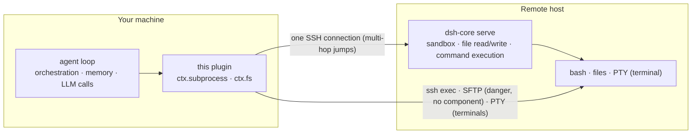

# dsh-workspace-enhancement

English | [中文](README.zh.md)

   

**A DeepSeek Harness (DSH) plugin that lets the agent work in remote workspaces over SSH.** The agent runs on your machine. When the workspace is remote, its shell, file and terminal tools run on that host. A session can hold **multiple workspaces** (a main directory plus side directories, local or remote), and the machines you register stay in your local `$DSH_HOME` (default `~/.dsh`). Built on [ssh2](https://github.com/mscdex/ssh2).

## Features

| Feature | Description |
|---|---|
| Remote workspaces | One SSH connection (multi-hop jump chains) carries shell commands, files, a terminal and directory browsing. Tools built on `ctx.subprocess` / `ctx.fs` work remotely with no code changes |
| Remote sandbox | `read-only` and `workspace-write` are enforced on a Linux remote when bubblewrap or Landlock can run. `danger-full-access` runs with the sandbox off. A terminal a person opens is not jailed; a model persistent shell in a confined tier is refused |
| Multi-workspace sessions | The **Workspace** button in the session header attaches extra directories (local or remote). The model can use a side root the operation targets; only a person can attach one, and a command in the main root cannot write a sibling root without an escalation |
| Add-workspace flow | Connection sidebar (local directory, saved machines, `~/.ssh/config` aliases) plus a directory browser |
| Machine settings | Add / edit / test machines, set a default, forget a host key. Host keys default to TOFU (`accept-new`); passwords are stored in plain text in the local machine registry unless you opt in per machine to the OS keychain |
| Session awareness | Sidebar rows show a remote marker and reachability (Checking / Reachable / Unreachable) and flag a changed host key |
| Model tools | `sw_status`, `sw_connect`, `sw_exec` (run a command on a registered machine by name); experimental `sw_use_machine`, off by default, and only on a 0.2.1+ host at `danger-full-access` with that machine already connected |
| Remote files | Uploads to a remote session land in the workspace's `.dsh-uploads/`; with [dsh-better-sidebar](https://github.com/omdsh-dev/DSH-better-sidebar) installed, a **Remote files** tab browses uploads and artifacts |
| Approval gate (legacy) | Per-machine approval before remote commands and terminals run; off by default, with no UI switch any more |
| Runtime localization | UI copy and tool errors follow the settings-page **Language** option (`zh` / `en`). Tool descriptions and the session prompt the model reads stay English |

## How it works



No DSH install on the remote: the model orchestrates locally, commands run remotely, and results come back into context.

### Remote component

The npm package ships a first-party binary, `dsh-core` (Go, Linux x86_64 / arm64). The first time a session needs it, it is uploaded over SFTP to `~/.dsh-core/` on the remote, where it runs as a long-lived `dsh-core serve` process speaking framed JSON-RPC. It does three things:

- **Sandbox** — under `read-only` / `workspace-write`, the process enters a bubblewrap jail when the remote has a usable `bwrap`, otherwise a Landlock jail. Landlock does not give a private `/tmp` or a PID namespace. Bubblewrap is not shipped; it has to be installed on the remote. `danger-full-access` still uses the component, with `--sandbox off`.
- **File read/write** — file operations are syscalls inside the component; `write` goes to a temporary file and is `rename(2)`d into place, so it is atomic.
- **Command execution** — the `argv` array is `exec`ed directly, with no shell command line; terminating a job sends `SIGKILL` to its whole process group.

File search is not a method of the component. If the remote already has ripgrep it is left alone; otherwise deploy tries to fetch the official `rg` build and place it beside the component. A failed fetch does not fail the deploy, and grep/glob then need `rg` on the remote.

Without the component — non-Linux remotes, Windows included, or a failed deploy — `danger-full-access` falls back to one `ssh exec` per command and to SFTP for files. `read-only` / `workspace-write` can still read over SFTP; writes and commands are refused until the session is `danger-full-access`. The same read-only refusal holds when the component is up but the remote has neither bubblewrap nor Landlock (Linux 5.13+); in that case `danger-full-access` still goes through the component with the sandbox off, not a bare `ssh exec`. The interactive terminal always opens a plain SSH PTY, component or not.

Details and known boundaries: [SECURITY.md](./SECURITY.md) and [docs/architecture.md](./docs/architecture.md).

## Install

```sh
# from npm
dsh plugin --profile web add dsh-workspace-enhancement
# from source: build first
npm run build
dsh plugin --profile web add <this-repo-path>
```

- Node ≥ 22.8. Building from source also needs Go 1.22+ to compile `dsh-core`. `npm run build` still finishes without Go, but then there is no remote component to deploy.
- If the first `add` fails because pnpm blocked install scripts, allow `ssh2` and `cpu-features` under `allowBuilds` in the profile's `pnpm-workspace.yaml`, then re-run it.

## Compatibility

Check your host with `dsh --version`:

| DSH host | Install |
|---|---|
| The `0.2.2`, `0.2.1` and `0.2.0` lines, and `0.1.7-rc.2` | latest |
| The `0.1.5` line | `0.2.2` |
| `alpha` builds, the `0.1.2` family and older | not supported |

Host and plugin must be upgraded together. The full window and history are in [docs/compatibility.md](./docs/compatibility.md).

## Roadmap

Public progress: [docs/ROADMAP.md](./docs/ROADMAP.md). The single backlog is [docs/backlog.md](./docs/backlog.md).

## Development

Rules and commands: [AGENTS.md](./AGENTS.md). Contribution flow: [CONTRIBUTING.md](./CONTRIBUTING.md). Document map: [docs/README.md](./docs/README.md) (the docs under `docs/` are in Chinese). One gate for everything: `npm run check`.

## References

- [dsh-ssh](https://github.com/UynajGI/dsh-ssh): remote execution engine — `ctx.subprocess` / `ctx.fs` providers, jump chains, PTY, directory-picker seam, `session.route` placeholder.
- [dsh-remote](https://github.com/flymysql/dsh-remote): workspace helper — machines registry, TOFU, OS keychain, web UI and settings page.

## License

MIT
