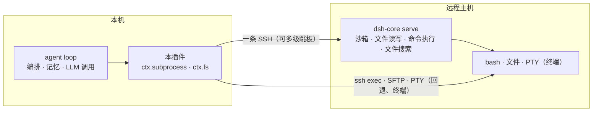

# dsh-workspace-enhancement

[English](README.md) | 中文

   

**一个 DeepSeek Harness（DSH）插件：让模型通过 SSH 在远程工作区里干活。** 模型在本机运行，shell、文件和终端工具在远端执行。一个会话可以挂**多个工作区**（主目录 + 一组副目录，本地或远程均可），注册的机器存在本机的 `$DSH_HOME`（默认 `~/.dsh`）。底层用 [ssh2](https://github.com/mscdex/ssh2)。

## 功能

| 功能 | 说明 |
|---|---|
| 远程工作区 | 一条 SSH（可多级跳板）承载 shell 命令、文件、终端和目录浏览；基于 `ctx.subprocess` / `ctx.fs` 的工具不用改代码 |
| 远程沙箱 | 会话权限档（`read-only` / `workspace-write` / `danger-full-access`）在远端生效 |
| 多工作区会话 | 标题栏「工作区」按钮把额外目录（本地或远程）挂为副工作区，模型可直接操作 |
| 添加工作区 | 连接侧栏（本机目录、已保存机器、`~/.ssh/config` 别名）+ 目录浏览器 |
| 机器设置 | 机器增删改、测试、设为默认、忘记指纹。主机指纹走 TOFU；密码默认明文存在本机的机器注册表里，可按机器转存 OS 钥匙串 |
| 会话感知 | 侧栏显示远程标识和可达性（检测中 / 可连接 / 不可连接），主机密钥变更会提示 |
| 模型工具 | `sw_status`、`sw_connect`、`sw_exec`（在指定的已注册机器上执行命令）；实验性 `sw_use_machine` 默认关闭 |
| 远程文件 | 远程会话的上传落到工作区的 `.dsh-uploads/`；装有 [dsh-better-sidebar](https://github.com/omdsh-dev/DSH-better-sidebar) 时多一个「远程文件」页，浏览上传与产物 |
| 审批门（遗留） | 远程命令和终端执行前的逐机器审批；默认关闭，已无界面开关 |
| 运行时国际化 | UI 与工具文案跟随设置页的 **Language** 选项（zh / en） |

## 工作原理



远程不用装 DSH：模型在本地编排，命令在远程跑，结果再回本地进上下文。

### 远程组件

npm 包自带一个第一方二进制 `dsh-core`（Go，Linux x86_64 / arm64）。会话第一次用到它时，它经 SFTP 自动上传到远端的 `~/.dsh-core/`，以长驻进程 `dsh-core serve` 的形式提供成帧 JSON-RPC。它负责四件事：

- **沙箱**：`read-only` / `workspace-write` 档下，进程进入 bubblewrap 或 Landlock 隔离。
- **文件读写**：文件操作是组件内的 syscall；`write` 先写临时文件再 `rename(2)`，是原子写。
- **命令执行**：`argv` 数组直接 `exec`，不经 shell 命令行；终止时对整个进程组发 `SIGKILL`。
- **文件搜索**：远端没有 ripgrep 时，使用随组件部署的 `rg`。

没有组件时（非 Linux 远端、部署失败），命令退回每条一次的 `ssh exec`，文件退回 SFTP，`read-only` / `workspace-write` 会话只读，直到你批准完全权限。远端既没有 bubblewrap 也没有 Landlock（Linux 5.13+）时同样如此。交互式终端始终走裸 SSH PTY，不经组件。

细节与已知边界见 [SECURITY.md](./SECURITY.md) 和 [docs/architecture.md](./docs/architecture.md)。

## 安装

```sh
# 从 npm 安装
dsh plugin --profile web add dsh-workspace-enhancement
# 源码安装：先构建
npm run build
dsh plugin --profile web add <本仓库路径>
```

- 需要 Node ≥ 22.8。从源码构建还需要 Go 1.22+ 来编 `dsh-core`；没有 Go 时构建仍能完成，但没有沙箱。
- 首次 `add` 若因 pnpm 拦截安装脚本而失败：在 profile 的 `pnpm-workspace.yaml` 里把 `ssh2` 和 `cpu-features` 加进 `allowBuilds`，然后重跑。

## 版本兼容

用 `dsh --version` 查看宿主版本：

| DSH 宿主 | 安装 |
|---|---|
| `0.2.2`、`0.2.1`、`0.2.0` 线，以及 `0.1.7-rc.2` | 最新版 |
| `0.1.5` 线 | `0.2.2` |
| `alpha` 构建、`0.1.2` 家族及更早 | 不支持 |

宿主与插件必须同步升级。完整支持窗口与历史见 [docs/compatibility.md](./docs/compatibility.md)。

## 路线图

公开进度见 [docs/ROADMAP.md](./docs/ROADMAP.md)。唯一待办真相源是 [docs/backlog.md](./docs/backlog.md)。

## 开发

规则与命令见 [AGENTS.md](./AGENTS.md)，贡献流程见 [CONTRIBUTING.md](./CONTRIBUTING.md)，文档地图见 [docs/README.md](./docs/README.md)（`docs/` 下的文档是中文）。统一质量门：`npm run check`。

## 参考项目

- [dsh-ssh](https://github.com/UynajGI/dsh-ssh)：远程执行引擎（`ctx.subprocess` / `ctx.fs` provider、跳板链、PTY、directory-picker 接缝、`session.route` 占位）。
- [dsh-remote](https://github.com/flymysql/dsh-remote)：工作区助手（machines 注册表、TOFU、OS 钥匙串、Web UI 与设置页）。

## License

MIT
